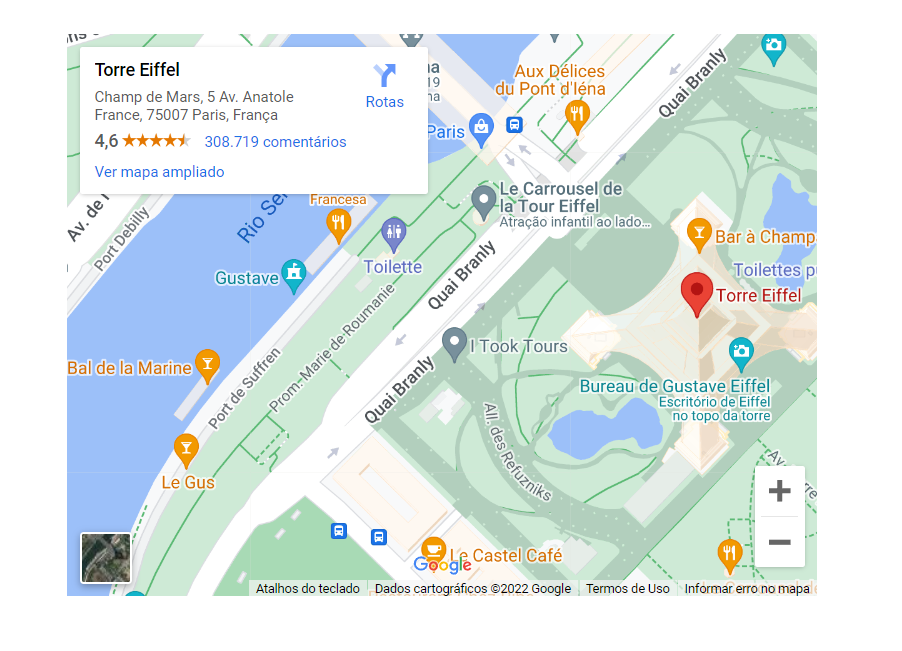

# Embed

Embed anything: PDFs, Google Docs, Google Maps, Spotify...

## Create

```php
$url = "https://goo.gl/maps/t7y33q3qfCBxr5489";
$block = Embed::fromUrl($url);
```



## HTML blocks

Embeds can also be backed by an uploaded file. When the uploaded file has an
`.html` or `.htm` extension, Notion renders it as an interactive HTML block.

```php
$fileUpload = $notion->fileUploads()->upload("report.html");

$block = Embed::fromFileUpload($fileUpload->id);
$notion->blocks()->append($pageId, [ $block ]);
```

An existing embed can be switched to an uploaded file with
`$embed->changeFileUpload($fileUploadId)`, or back to a URL with
`$embed->changeUrl($url)`.

Embeds always read back from the API with a temporary, signed `url` and a
`null` `fileUploadId`. Fetch the block again to get a fresh URL instead of
caching it.
