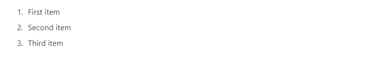

# Numbered list item

List with numbering.

## Create from string

```php
$blocks = [
    NumberedListItem::fromString("First item"),
    NumberedListItem::fromString("Second item"),
    NumberedListItem::fromString("Third item"),
];
```




## List start index and format

The first item of a list can define the number the list starts at and how it is
numbered (`NumberedListFormat::Numbers`, `NumberedListFormat::Letters` or
`NumberedListFormat::Roman`).

```php
use Notion\Blocks\NumberedListFormat;
use Notion\Blocks\NumberedListItem;

$blocks = [
    NumberedListItem::fromString("Third item")
        ->changeListStartIndex(3)
        ->changeListFormat(NumberedListFormat::Roman),
    NumberedListItem::fromString("Fourth item"),
];
```

Both values are `null` when not set, and only present on the first item of a list
when retrieved from Notion. Pass `null` to remove them.
